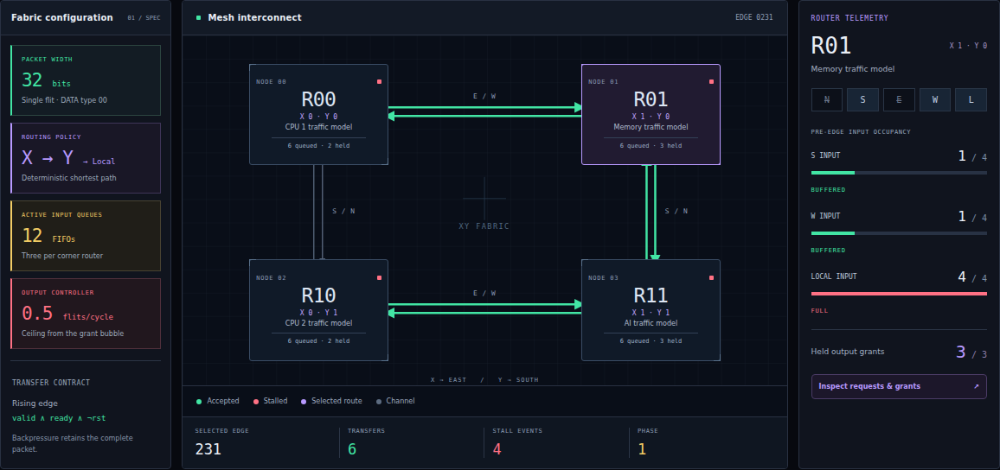
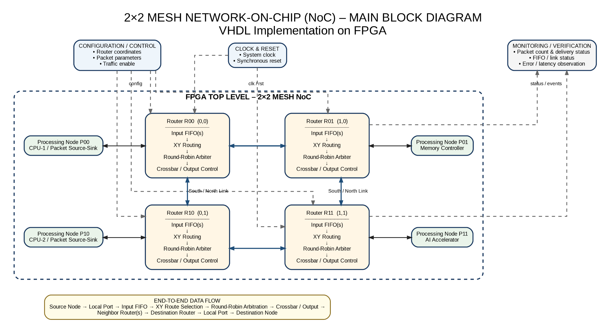
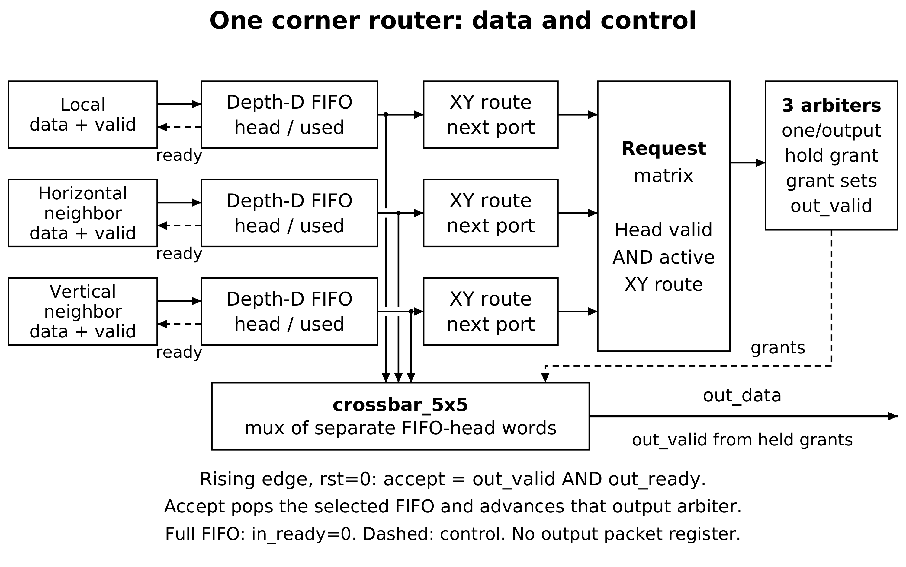
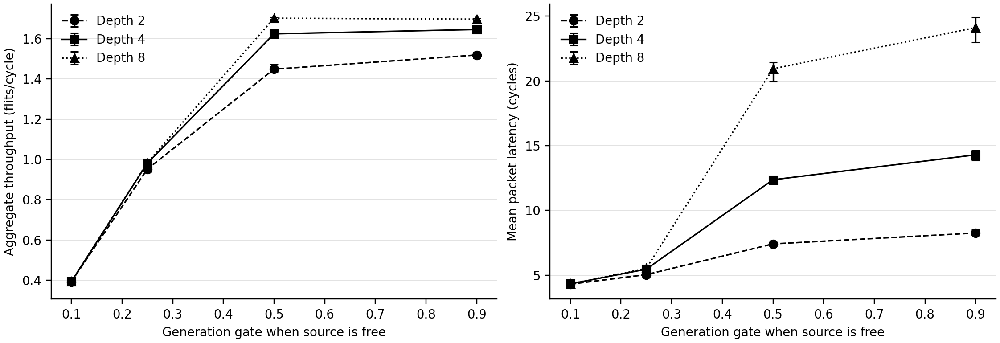
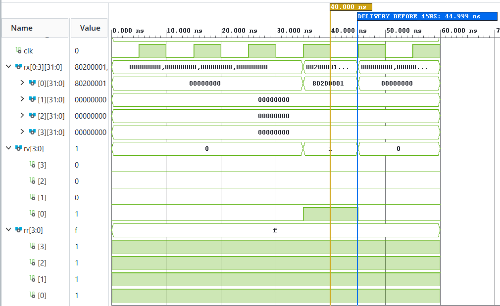
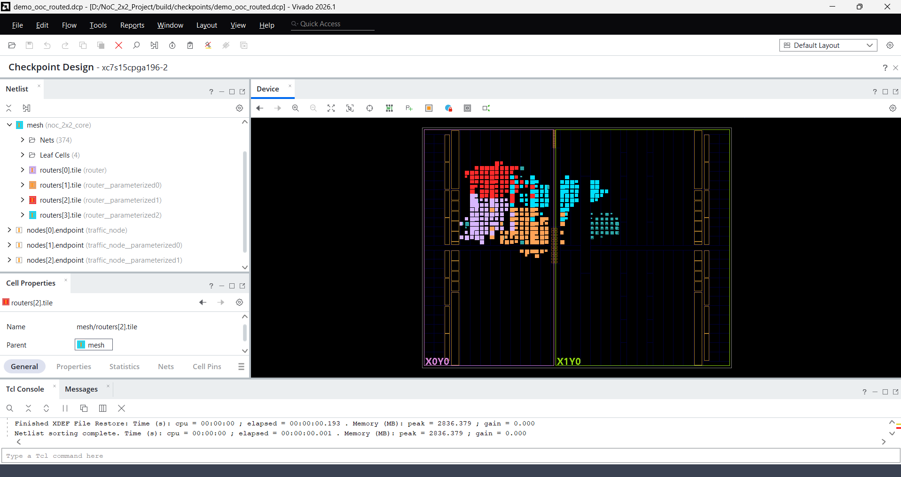
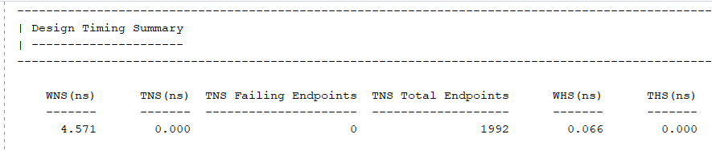

<div align="center">

# 2 × 2 MESH NETWORK-ON-CHIP

**VHDL-2008 · XY routing · Round-robin arbitration · Ready/valid flow control**

An evidence-led HDL & PLD mini project from **DES Pune University · B.Tech ECE · 2026–27**

[](https://github.com/DevenGaikwad/vhdl-2x2-mesh-noc/actions/workflows/portable-checks.yml)
[](rtl/compile_order.txt)
[](constraints/clock_only.xdc)
[](experiments/results/metrics.json)

[Architecture](#architecture) · [Results](#measured-results) · [Run it](#quick-start) · [Evidence gallery](#evidence-gallery) · [Documents](#documentation-and-downloads) · [Team](#project-team)

</div>

This project builds a small on-chip packet network in synthesizable VHDL. Four routers buffer packets, choose a deterministic XY route, arbitrate competing requests and transfer one 32-bit flit whenever **valid and ready are both high at a rising clock edge**. Self-checking testbenches test the actual RTL; the browser dashboard makes recorded packet journeys easier to inspect.



*Original report figure: the dashboard replays a recorded directed trace at edge 231. The green links represent logged accepts. The browser does not execute VHDL or communicate with a physical FPGA.*

## What is implemented

| Layer | Implementation |
|---|---|
| Network | Four routers, four local endpoints and eight directed neighbor links |
| Routing | Deterministic **X first, Y second, then Local**; router index `X + 2Y` |
| Packets | One 32-bit flit per packet; explicit source, destination, ID and payload fields |
| Buffering | Three active input FIFOs per corner; default depth 4, verified depths 1/3/4/8 |
| Arbitration | One retained round-robin grant per active output; stable under backpressure |
| Flow control | Synchronous ready/valid; synchronous active-high reset |
| Demonstration wrapper | Four finite traffic nodes, status outputs and a delivered counter |
| Visualization | Vanilla TypeScript/Vite dashboard, CSV packet replay and imported Vivado summaries |
| Verification | Six testbenches, fourteen supplemental configurations and 93 archived experiments |

The finite endpoint labels are traffic models. This educational design does not implement four commercial processors, caches or an operating system.

## Architecture



Each router has five *logical* ports: **North=0, South=1, East=2, West=3, Local=4**. A corner activates Local and its two valid geographical directions. Inactive boundary inputs are disabled. Across the mesh there are **12 active FIFOs, 12 route units, 12 output arbiters and four five-port crossbars**.

Coordinates are R0=(0,0), R1=(1,0), R2=(0,1), R3=(1,1). A packet from R0 to R3 follows **R0 → R1 → R3 → Local**. Each neighboring router accepts the same full 32-bit word through its FIFO interface. Independent links may transfer concurrently; packets competing for one output take turns.



*FIFO heads feed routing requests; each output holds its selected grant until acceptance. These are logical RTL relationships, not physical placement coordinates.*

See [architecture](docs/architecture.md), [module contracts](docs/module_contracts.md), [packet protocol](docs/protocol.md) and the [conventional XY flowchart](docs/assets/architecture/05-xy-flowchart.png).

## Packet and handshake contract

| Bits | Meaning |
|---|---|
| 31 | Packet marker, `1` |
| 30:29 | DATA type, `00`; other types are unsupported |
| 28 / 27 | Source X / Y |
| 26 / 25 | Destination X / Y |
| 24:21 | Four-bit ID, 0–15 |
| 20:19 | Reserved priority bits; baseline does not use weighted priority |
| 18:0 | Nineteen-bit payload |

On a rising clock edge with `rst=0`, **transfer = valid AND ready**. A producer holds both data and valid while stalled. A high ready signal alone means capacity is available; it does not mean a packet moved. A hexadecimal `F` on a four-bit ready vector means `1111`: all four local interfaces are ready.

Debug outputs flatten router and port as `j = 5 × router + port`. Thus `OD[4]` and `OV[4]` describe Router 0's Local output. `TV/TR` describe source injection; `RV/RR` describe destination ejection. Exact names and directions are documented in the [protocol guide](docs/protocol.md).

## Evidence status

These outcomes describe different tools and scopes. CI checks repository portability; it does not run Vivado.

| Gate | Recorded result | Evidence |
|---|---|---|
| Local portable suite | **14 PASS**, archived GHDL 6.0.0 | [Verification index](evidence/ghdl/verification.json) |
| XSim behavioral suite | **14 PASS**, Vivado 2026.1 | [Saved XSim logs](evidence/vivado/xsim) |
| Original benchmark study | **93 drained runs**, GHDL 4.1.0 | [Metrics](experiments/results/metrics.json), [traces](experiments/results/traces), [logs](experiments/results/logs) |
| Frontend regression | **22 parser tests**, TypeScript and production build | [Test source](frontend/src/data.test.ts), [workflow](.github/workflows/portable-checks.yml) |
| Core synthesis | Exact-part out-of-context synthesis completed | [Raw reports](evidence/vivado/synthesis_ooc) |
| Demo implementation | Placed and fully routed; internal static timing met | [Raw reports](evidence/vivado/route_demo_ooc) |
| Supplemental functional netlist | Console-supported **64 deliveries at 530 ns** | [Original console](evidence/supplemental/Postroute_Functional_Console_Original.txt) |
| SDF post-route timing simulation | **Failed at 20,150 ns; unresolved/deferred** | [Original diagnostics](evidence/supplemental/Postroute_Timing_Diagnostics_Console_Original.txt) |
| Physical FPGA demonstration | Outside demonstrated scope | [Limitations](docs/limitations.md) |

The post-route functional console is supplied historical evidence; its DCP/netlist bytes are not part of the recovered distribution. It is not presented as a newly reproduced simulation. A successful process exit never overrides a failure assertion.

## Measured results

### Packet accounting

The **93 benchmark runs** accepted and delivered **82,523 packets**, with zero reset discards and zero outstanding packets. Every run's original trace SHA-256, configuration and completion counts are checked by the evidence verifier.

The separate directed reset test finishes at **2400 ns** with **106 accepted = 74 delivered + 32 intentionally reset-discarded**. It also records 18 concurrent edges and a maximum of 32 outstanding packets. These reset-test counts are not mixed into the 93-run benchmark totals.

General accounting is **accepted = delivered + reset_discarded + outstanding**. An offered packet is counted as accepted only on a handshake.



*Original report plot. Three-seed arithmetic means; whiskers indicate observed minimum and maximum, not confidence intervals. The complete per-run records remain available.*

### FPGA resources and static timing

| Run / top | LUTs | Flip-flops | Setup WNS | Target / scope |
|---|---:|---:|---:|---|
| Archived `noc_2x2_core` synthesis | 1,086 | 147 | +6.233 ns | 10 ns, OOC synthesis |
| Later GUI core observation | 1,085 | 147 | +6.129 ns | Separate screenshot observation |
| Routed `noc_fpga_demo_top` | 1,067 | 236 | +4.571 ns | 10 ns, OOC routed fabric |

The routed wrapper uses 841 logic LUTs and 226 memory LUTs, with zero BRAM/DSP use. Its reports show TNS=0, WHS=+0.066 ns and THS=0. The route-status screenshot records **1468 routable nets fully routed and zero routing errors**.

**A 10 ns period is a 100 MHz target, not a measured maximum operating frequency.** Positive internal slack does not establish external board timing. Missing external I/O delays and CFGBVS-1 / RTSTAT-10 warnings remain documented. The two core observations are retained separately; a one-LUT difference is not claimed as an optimization.

An empty network gives Local/one-hop/two-hop acceptance-to-ejection latency of **2/4/6 cycles** under the stated test conditions. The registered arbiter has a bubble between accepts: **0.5 flits/cycle is an individual-output ceiling**, not a mesh-wide aggregate ceiling. [Definitions and interpretation →](docs/results.md)

## Quick start

### Dashboard on Windows

Prerequisites: Node.js 24.19 or later within major 24, npm and a source checkout. Publication checks use Node 24.22.1. Open PowerShell in the repository root:

```powershell
Set-Location .\frontend
npm ci
npm test
npm run build
npm run dev -- --host 127.0.0.1 --port 5173 --strictPort
```

Open **http://127.0.0.1:5173/**. Keep that terminal running; press **Ctrl+C** to stop it. Select a bundled trace, inspect a packet and visit the resource/verification views. The two measured resource rows load saved synthesis and routed-summary JSON files.

### Check the saved evidence

From the repository root, with Node installed:

```powershell
node .\scripts\verify_publication.mjs
node .\scripts\verify_evidence.mjs
```

The first checks publication-file hashes and canonical screenshot counts. The second checks the archived sources, 14 GHDL logs, 14 XSim logs, 12 Vivado report records and all 93 trace/log pairs. It writes a deterministic audit JSON; it does not rerun a simulator.

### Run the HDL again

Install GHDL with VHDL-2008 support. Use a disposable checkout because the runner writes new logs and directed traces:

```powershell
git clone . ..\NoC-Verification
Set-Location ..\NoC-Verification
node .\scripts\run_ghdl.mjs
```

There are fourteen self-checking configurations. This does not rerun the 93 performance experiments; the [reproduction guide](docs/reproducibility.md) explains the separate runner. Do not use `--help` on the historical GHDL runner: it starts execution.

### Vivado 2026.1

Use a separate verification checkout to preserve the saved baseline. With the exact Spartan-7 part installed:

```powershell
.\scripts\run_vivado.ps1 -Task Verify -VivadoCommand 'E:\Vivado-ML\2026.1\Vivado\bin\vivado.bat'
.\scripts\run_vivado.ps1 -Task Synthesize -VivadoCommand 'E:\Vivado-ML\2026.1\Vivado\bin\vivado.bat'
.\scripts\run_vivado.ps1 -Task RouteDemo -VivadoCommand 'E:\Vivado-ML\2026.1\Vivado\bin\vivado.bat'
```

E: is the original lab installation, not a universal prerequisite. `-ProjectDir` can override the wrapper's E-drive project location. No board pins, bitstream or board programming are implied by RouteDemo. [Full Windows instructions →](docs/implementation_guide.md)

## Evidence gallery

| RTL packet delivery | Routed fabric and timing |
|---|---|
|  |  |
| The packet word and valid/ready establish the observed transfer event. | Colored cells show placed router logic, not moving packets. |



*Saved internal static timing of the routed demonstration wrapper. Static timing analysis is distinct from the deferred SDF waveform simulation.*

The [screenshot index](docs/screenshot_index.md) accounts for **all 42 images**: the 31 walkthrough steps contain split 09A/09B views, followed by ten supplementary captures. Setup-only screenshots are identified as context rather than proof of packet delivery.

## Documentation and downloads

| Start here | Contents |
|---|---|
| [Document catalogue](docs/document_catalogue.md) | Current report, source-code printout, all-screenshot document, reviewed walkthrough and historical archives |
| [Architecture](docs/architecture.md) | Topology, router internals and module connections |
| [Verification](docs/verification.md) | Gates, test matrix, provenance and limits |
| [Results](docs/results.md) | Latency, throughput, reset accounting, LUTs and timing |
| [Dashboard guide](docs/dashboard_guide.md) | How to demonstrate recorded packet journeys |
| [Screenshot index](docs/screenshot_index.md) | 42 full images and precise observations |
| [Reproduction](docs/reproducibility.md) | Portable tests and separate benchmark runner |
| [Release v1.0.0](https://github.com/DevenGaikwad/vhdl-2x2-mesh-noc/releases/tag/v1.0.0) | Complete distribution and unchanged academic Word documents |
| [Manuscript draft](paper/README.md) | October 11 IEEE-format draft and source; not published research |
| [Provenance](docs/provenance.md) | Original archives, hashes, publication changes and source inventory |

A normal checkout contains editable VHDL, all 93 raw trace/log pairs, frontend source/public data, saved tool reports and the 42 screenshot assets. Regenerable builds and large Word documents are supplied through release assets. The full release ZIP brings both together. Original source and documentation archives retain their original names and hashes.

## Source map

| Path | Purpose |
|---|---|
| [`rtl/`](rtl) | Eleven design files and the authoritative compile-order list |
| [`tb/`](tb) | Six testbenches: FIFO, XY route, round-robin, router, demo and mesh |
| [`constraints/`](constraints) | Clock-only XDC and clearly marked unverified board-pin template |
| [`vivado/`](vivado) | Project, behavioral verification, OOC synthesis/routing and report Tcl |
| [`scripts/`](scripts) | Simulation, evidence, CSV analysis, report import and launch utilities |
| [`experiments/results/`](experiments/results) | 93 configurations, raw traces/logs and metrics |
| [`frontend/`](frontend) | Dashboard source, lockfile, data and 22 parser tests |
| [`evidence/`](evidence) | Archived compiler/XSim logs, Vivado reports and publication checks |
| [`docs/`](docs) | Guides, diagrams, screenshot index and original package indexes |

## Limitations and next research questions

This is a small deterministic, single-flit educational network. There are no virtual channels, adaptive routing, multi-flit wormhole packets, verified external I/O constraints, power measurements or physical-board results. SDF timing simulation remains unresolved; the saved functional PASS and positive static slack do not close that gate.

The source and experiment traces support study of latency, offered/accepted rate, per-output service and FIFO occupancy. A paper-level comparison still needs a justified baseline, longer trials, clear workload eligibility for fairness and independent review. Endpoint service imbalance alone is not proof of arbiter starvation. [Complete limitations →](docs/limitations.md)

## Project team

| Student | PRN | GitHub |
|---|---|---|
| **Anjor Giri** | 1022411048 | [@anjor022](https://github.com/anjor022) |
| **Nidhi Kanoujia** | 1022411051 | [@nidhikanoujia-dev](https://github.com/nidhikanoujia-dev) |
| **Deven Gaikwad** | 1022411052 | [@DevenGaikwad](https://github.com/DevenGaikwad) |

**Faculty / mentor:** Dr. Madan Mali · **Institution:** DES Pune University · **Academic year:** 2026–27.

All three students are credited as project contributors. GitHub's automated Contributors graph derives from actual commits and may differ from this team table. No individual task ownership or past co-authored commit history has been invented. [Contribution guide](CONTRIBUTING.md) · [Team credits](CONTRIBUTORS.md)

## References and reuse

The technical background and full bibliography are in the [literature review](docs/literature_review.md) and [manuscript references](paper/references.bib). Tool guidance: [AMD Vivado documentation](https://docs.amd.com/), [GHDL documentation](https://ghdl.github.io/ghdl/), [Vite documentation](https://vite.dev/guide/).

No project-wide open-source license has been selected by the team. Third-party tools and bundled IEEE formatting files retain their own notices; see [third-party notices](THIRD_PARTY_NOTICES.md). Repository visibility does not itself grant reuse permission.
