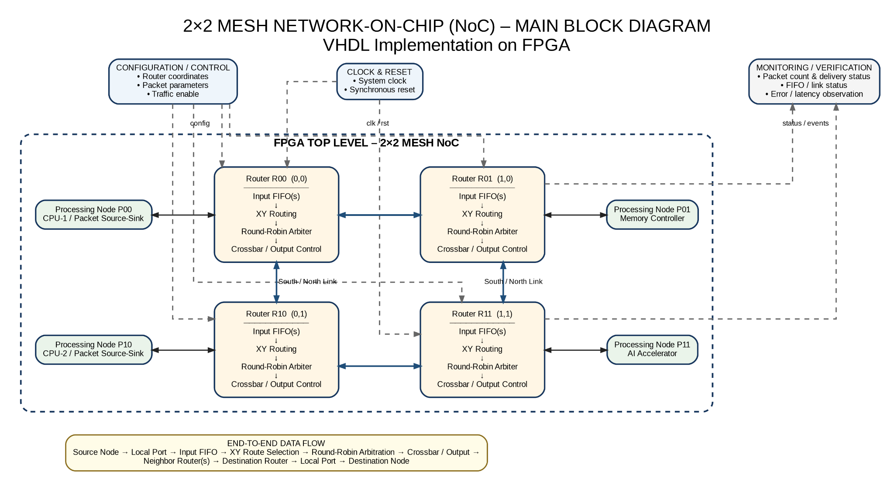
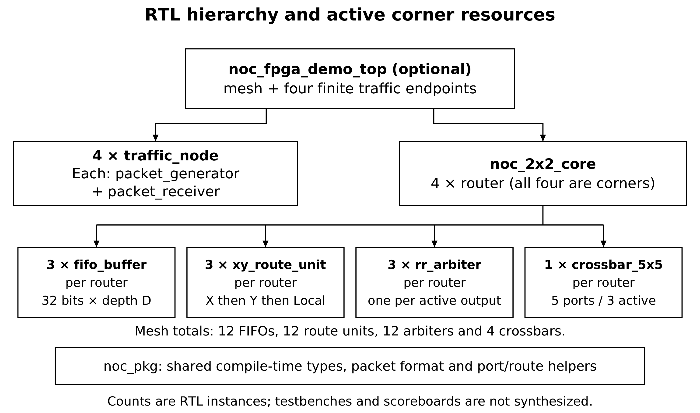
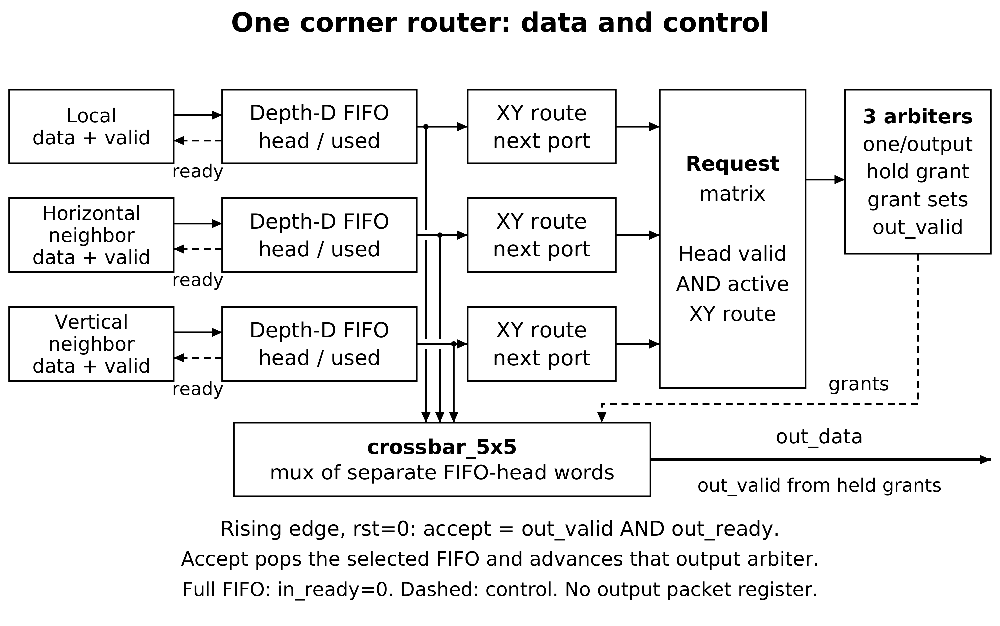

# Architecture

The implemented design is a 2 × 2 deterministic mesh, not a future unconnected router proposal. Four `router` instances in `noc_2x2_core` connect four local injection/ejection interfaces. The demo wrapper adds finite traffic sources and sinks.

| Router | Coordinate | Active directions | Mask `L W E S N` |
|---|---|---|---|
| 0 | (0,0) | E, S, L | 10110 |
| 1 | (1,0) | W, S, L | 11010 |
| 2 | (0,1) | E, N, L | 10101 |
| 3 | (1,1) | W, N, L | 11001 |

Y increases southward. `noc_pkg.route_to` compares destination X first; only when X matches does it compare Y. Matching both coordinates selects Local. Each bidirectional drawing edge comprises two independent data/valid channels with ready feedback: eight directed neighbor channels in total.

Each corner instantiates three live FIFO/route paths and three live output arbiters, plus one five-logical-port crossbar. The mesh totals 12 FIFOs, 12 route units, 12 arbiters and four crossbars. The shared package defines types/functions and is not another hardware instance. Inactive boundary ports are tied off; indices remain uniform across routers.

An input FIFO stores a full flit and exposes its oldest word. The route unit selects one requested output. The arbiter scans requests from its rotating pointer, captures a grant, and holds that grant until downstream acceptance. The crossbar chooses the corresponding FIFO head. Acceptance pops that FIFO and pushes the next router's input on the same rising edge. The registered grant controller has one bubble after acceptance.

For R0 to R3: source acceptance at R0 Local FIFO → R0 East output → R1 West input → R1 South output → R3 North input → R3 Local output → destination acceptance. In the empty-network reference test this spans six cycles from accepted injection to ejection. A stall can extend it; six cycles is not a bound under congestion.

The package, packet layout and edge protocol are defined in [protocol.md](protocol.md). Actual source interfaces and generic defaults are in [module_contracts.md](module_contracts.md). Synchronous reset clears accessible FIFO occupancy/pointers and held arbitration state, not every memory bit. Accepted packets pending at reset become explicit reset discards in the testbench.
