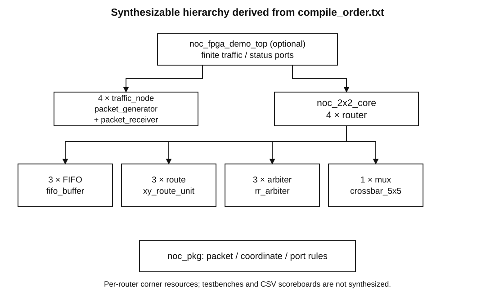

# Module contracts and compile order

| Entity/package | Generics | Ports or role | Contract |
| --- | --- | --- | --- |
| noc_pkg | none | packet/coordinate/port types; layout and route helpers | Shared by RTL and tests; port indices N=0, S=1, E=2, W=3, L=4 |
| fifo_buffer | DEPTH positive, default 4 | clk/rst; in_data/valid/ready; out_data/valid/ready; count | Registered occupancy; no bypass; reset flush; full push+pop accepts pop only |
| xy_route_unit | CURRENT 0..3 | packet; requested_port natural | Combinational X→Y→Local; guarded unknown startup data |
| rr_arbiter | none | clk/rst; requests ports; accept; grant; priority pointer | Registered one-hot hold; advances on accept; five-successful-grant persistent bound |
| crossbar_5x5 | none | 5 FIFO heads; 5 one-hot grants; 5 output words | Combinational mux; zero when no grant; no data storage |
| router | CURRENT 0..3; DEPTH=4 | 5 data/valid/ready input/output arrays; count/request/grant debug | 3 active FIFOs/route units/arbiters; local no-load acceptance-to-ejection: 2 cycles |
| noc_2x2_core | DEPTH=4 | clk/rst; 4 injection/ejection interfaces; 20 flattened debug ports | 4 router tiles, eight directed links; index debug=5*router+port |
| packet_generator | NODE=0..3; PACKETS=16 | clk/rst/start; data/valid/ready; done | Finite stable producer; each destination sent mod 4; default 16 packets/node |
| packet_receiver | NODE=0..3 | clk/rst; data/valid/ready; error; received count | Always-ready sink; checks legal/destination/payload source+sequence ID |
| traffic_node | NODE=0..3; PACKETS=16 | clk/rst/start; injection/ejection; done/error/count | Pair of finite source and sink; only traffic model |
| noc_fpga_demo_top | DEPTH=4; PACKETS=16 | clk/rst/start; done/error/busy; delivered[15:0] | Internal 4 nodes; default 64 packet run; reset required to rerun; no board pins |

`rtl/compile_order.txt` is authoritative. Read package, FIFO/route/arbiter/mux, router, core, generator/receiver, traffic_node, demo top; then testbenches. All design sources use VHDL-2008, ieee.std_logic_1164 and numeric_std where arithmetic is used. Debug counts are natural arrays for simulation visibility; array ports are logical flattened interfaces during synthesis, not physical buses assigned to a package. No black boxes or placeholder modules are present. Rich random generation, expected-packet tables, TextIO and std.env.finish exist only in testbenches.

