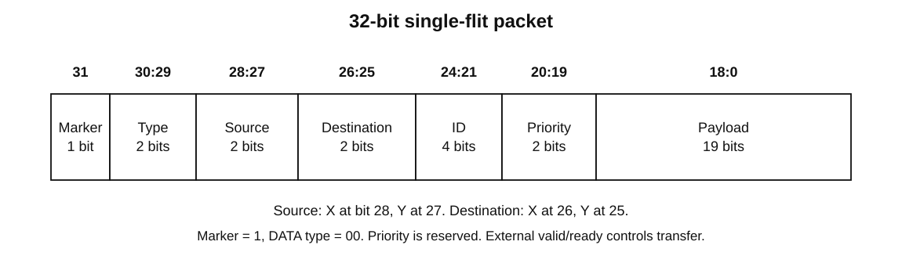
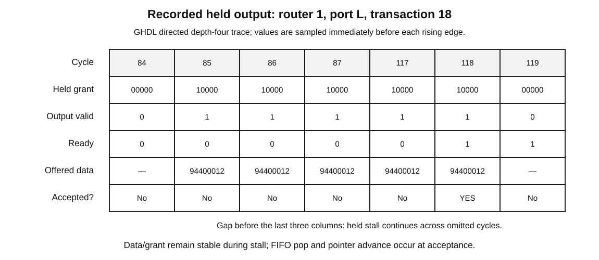

# Packet and handshake specification

Width is 1+2+2+2+4+2+19=32. DATA is type bits 00; marker is 1. Source X is bit 28 and source Y bit 27; destination X bit 26 and destination Y bit 25. `source_of`/`destination_of` return X+2Y. Packet IDs 0..15 wrap, while baseline priority is reserved and ignored. Payload is 0..524287. make_packet asserts legal ranges in simulation.

Unsupported marker/type encodings are outside the legal baseline input contract. The router's accepted-input assertion fails in simulation; synthesis translates off that diagnostic. The hardware datapath does not inspect type to drop packets or return errors. Priority has no fairness weight. A source may assert external valid only with an entirely known, legal packet.

## Acceptance and reset

Normal transfer: rising edge, rst=0, valid=1, ready=1. A producer retains both valid and all 32 data bits while valid=1 and ready=0. Valid must not wait for ready. A receiver may refuse a full FIFO and a sink may backpressure. No incoming transfer may target an inactive boundary port.

Reset is active-high synchronous and overrides all normal transfers at its rising edge. Sources must deassert valid during reset; observations on reset edges are not normal acceptances. Reset clears FIFO used/pointers and held arbiter grants/pointers; memory contents are inaccessible while empty and need not be physically cleared. Any previously accepted pending packet is explicitly classified reset_discard by the testbench. Presented-but-unaccepted requests cancelled by reset are attempts, never scoreboard accepted packets.

## FIFO boundaries

| Pre-edge state | push attempt | pop attempt | Accepted operations | New count |
| --- | --- | --- | --- | --- |
| Empty | yes | yes | push only | 1 |
| 0 < count < DEPTH | yes | yes | both | unchanged |
| Full | yes | yes | pop only; producer retries | DEPTH−1 |
| Full | yes | no | neither | DEPTH |
| Empty | no | yes | neither | 0 |

Pointer advance explicitly wraps at DEPTH−1, including non-power-of-two depths. The unit suite tests depths 1,3,4,8. DEPTH=1 cannot perform a simultaneous accepted push/pop with this registered-capacity policy.

## Output and order

A FREE arbiter captures the first request scanning from its rotating pointer. HELD ignores later request changes and stalls until accept. Accepted output pops that selected input, clears grant and sets pointer=(winner+1) mod 5. A new request captures on the following edge, causing one arbitration bubble. Local output transfer is accepted delivery; directional output transfer is a link movement and neighbor FIFO push on the same edge.

Packets from one source/destination stream remain ordered in the self-checking mesh. No global order is asserted between independent sources. Four-bit ID alone is insufficient for unlimited outstanding packets. The scoreboard uses globally unique payload values for its bounded runs; this is a testbench identity convention, not a new protocol field or permanent application requirement.

