# Screenshot index — all 42 supplied images

The sequence contains 31 walkthrough steps, split 09A/09B panels and ten supplementary captures. Each image is extracted byte-for-byte from `NoC_Screenshots_All_Received.docx`. The image hash and original caption are recorded in [index.json](assets/vivado/index.json). Setup images provide context; they do not independently prove functional correctness.

## 01 — Project and exact FPGA target

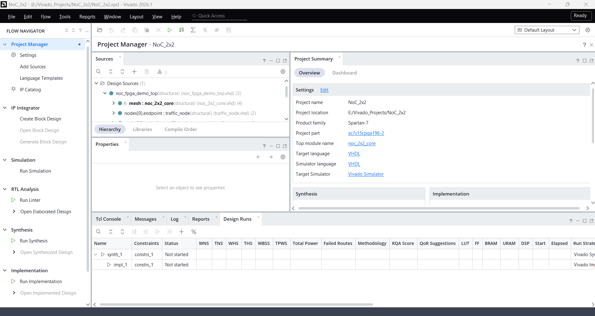

Vivado opens NoC_2x2 for Spartan-7 xc7s15cpga196-2.
This establishes project setup; opening the project alone does not verify packet transfer.

## 02 — Simulation sources

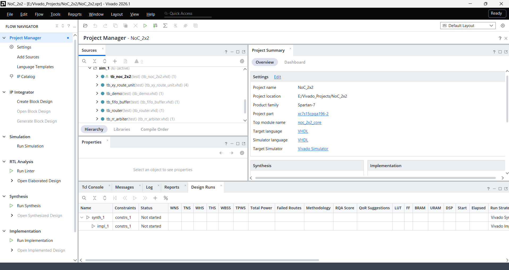

tb_noc_2x2 is the system testbench; module testbenches are also listed.
A testbench generates clock, reset and traffic, then checks the VHDL circuit.

## 03 — Behavioral simulation loaded

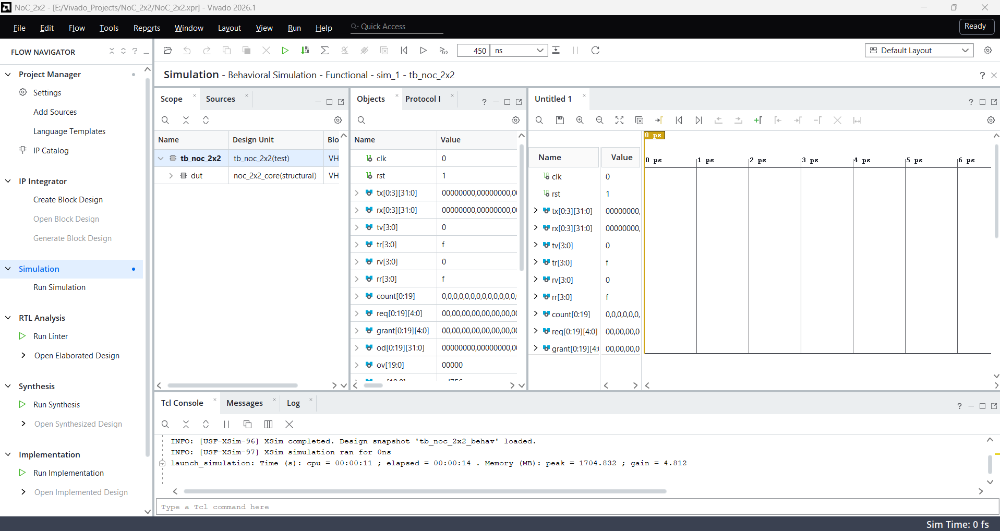

XSim elaborates the mesh and exposes its data, handshake and debug signals.
Simulation is at time zero; the loaded window is not yet a successful test result.

## 04 — Clock and reset through 60 ns

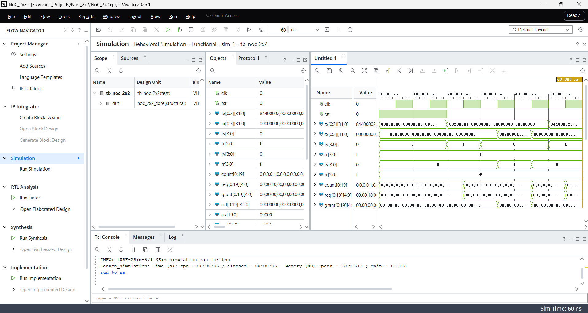

The testbench clock period is 10 ns; reset is released at about 20 ns.
TV and RV activity begins afterward. The 60 ns view is only an early observation window.

## 05 — First injection at 25 ns

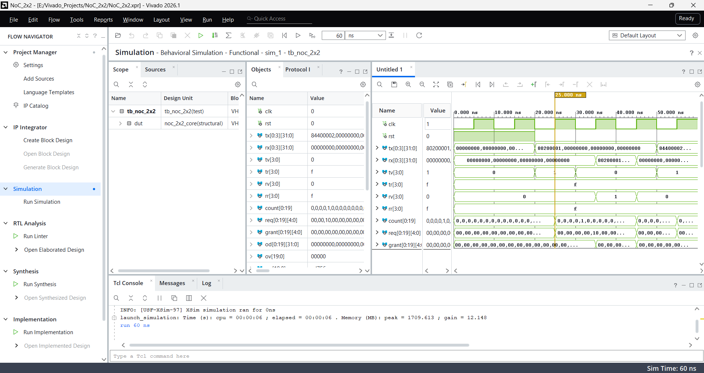

TX(0)=0x80200001 is accepted when TV(0)=TR(0)=1 on the rising edge.
The decoded source and destination are both 0: this first example takes the Local route.

## 06 — Packet offered at the receiver

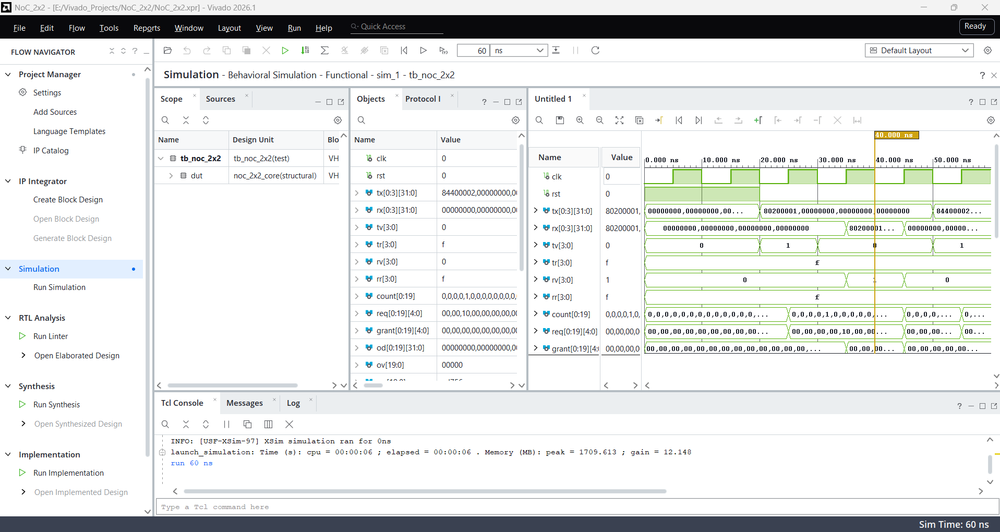

At the 40 ns cursor, RX shows 0x80200001 and receive-valid is asserted.
The packet is being offered; acceptance occurs at the following 45 ns rising edge.

## 07 — FIFO occupancy at 25 ns

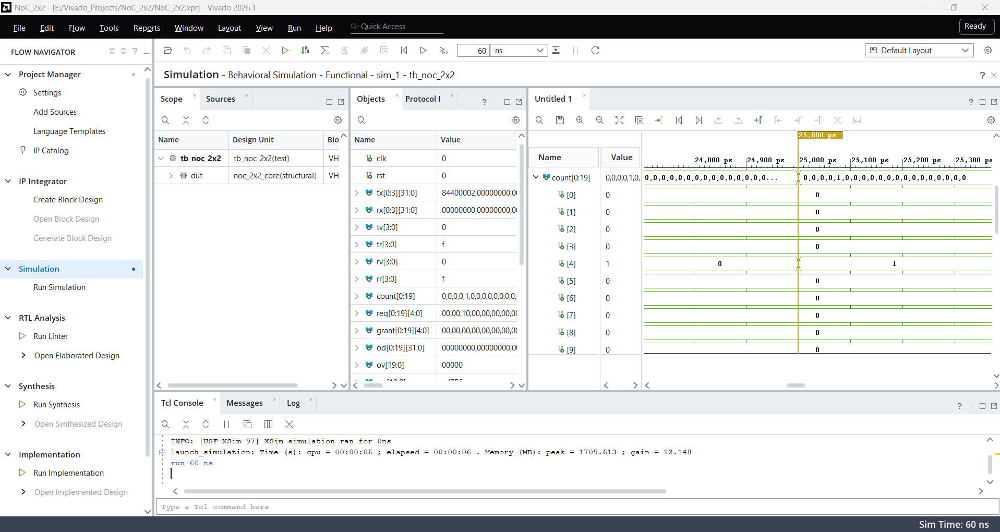

count[4] rises from 0 to 1 after injection. Index 4 is Router 0 Local input.
The FIFO stores one 32-bit packet; DEPTH=4 permits four queued packets at that active input.

## 08 — Routing request and cursor time

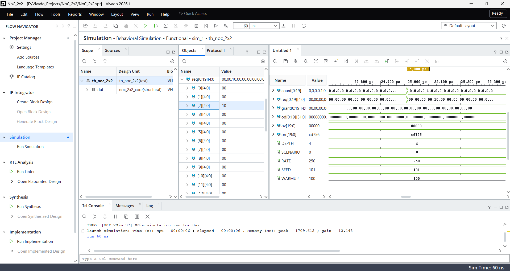

At 25 ns the request mask is 0x10: input bit 4 requests an output; grants remain zero.
The left Objects req[2]=0x10 is at current time 60 ns, not the selected 25 ns Wave cursor.

## 09A — Selected internal output data

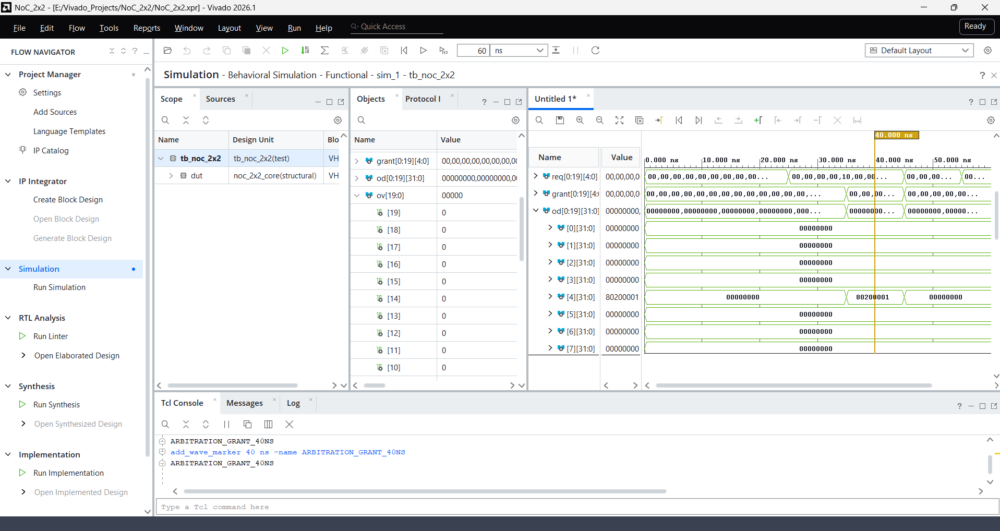

At 40 ns, OD[4]=0x80200001 carries the original complete packet word.
Debug index 4 denotes Router 0 Local output. Read the Wave value, not current-time Objects.

## 09B — Selected internal output valid

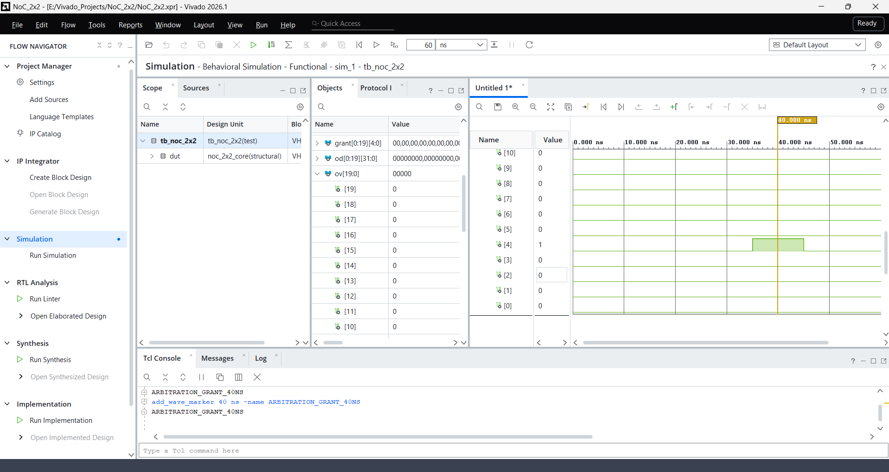

At 40 ns, OV[4]=1 indicates that OD[4] is actively offering its packet.
Together, 09A and 09B show data plus validity; the delivery handshake still needs READY.

## 10 — Receiver handshake before 45 ns

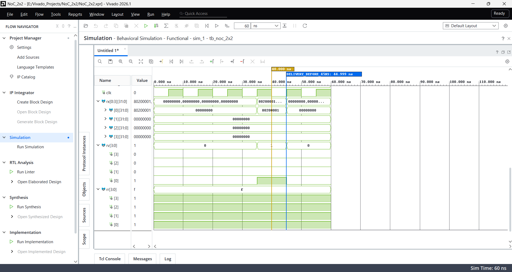

At 44.999 ns, receiver 0 has the packet with RV(0)=RR(0)=1.
These signals satisfy delivery acceptance at the 45 ns rising edge; this packet is Local.

## 11 — Local packet latency

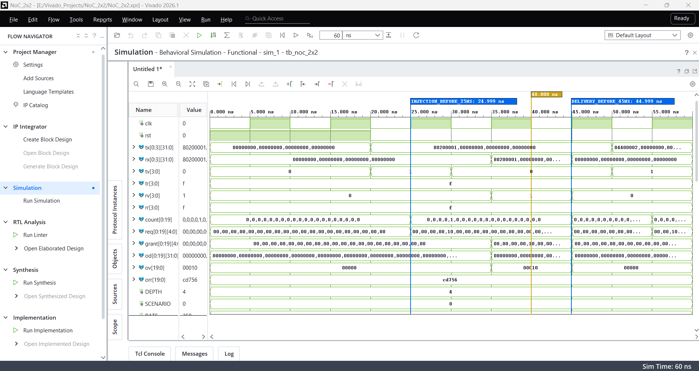

Injection at 25 ns and delivery at 45 ns give 20 ns, or two 10 ns clock cycles.
This is the Local example. Empty one-hop and two-hop paths use four and six cycles.

## 12 — Self checking XSim PASS

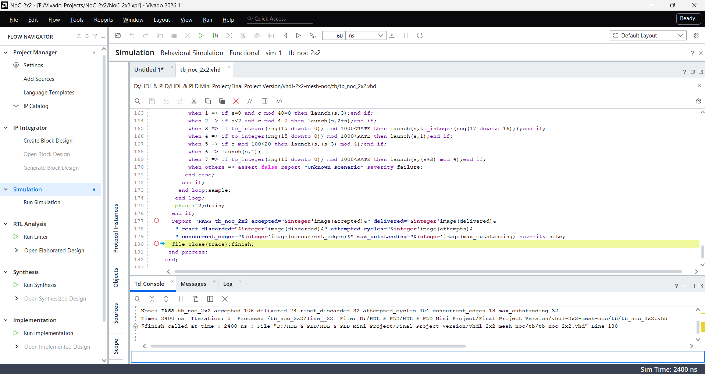

At 2400 ns: 106 accepted = 74 delivered + 32 intentional reset discards.
All accepted traffic is accounted for. The 93 benchmark runs are a separate population.

## 13 — Four router RTL hierarchy

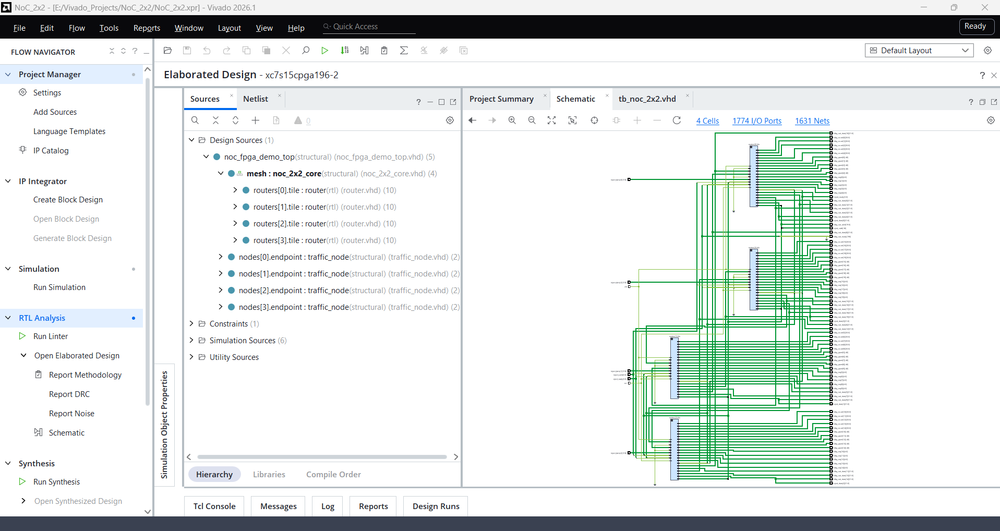

The wrapper contains a mesh and four traffic endpoints; the mesh has four routers.
Endpoint CPU or AI names are traffic-model labels, not implemented processors.

## 14 — One corner router hierarchy

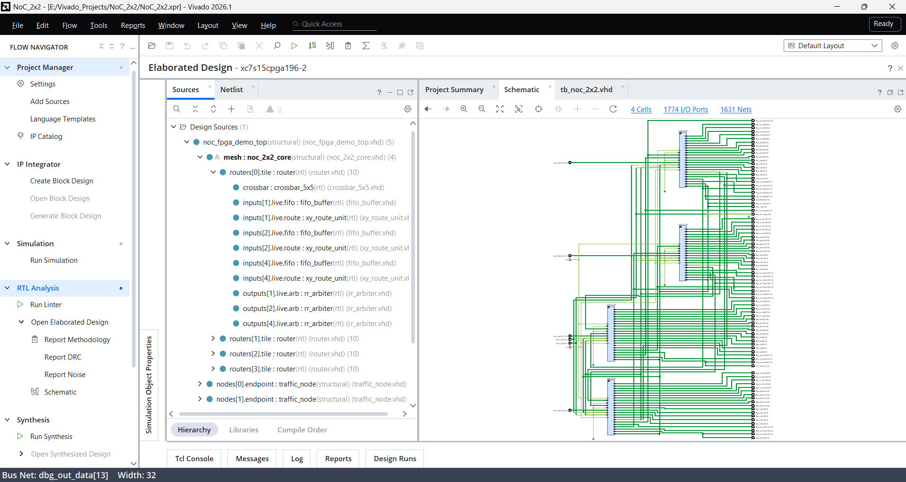

Router 0 has a crossbar, three active FIFOs, routing units and output arbiters.
Only Local, South and East connect there. Every corner has its own two inactive directions.

## 15 — Synthesized FIFO primitive classes

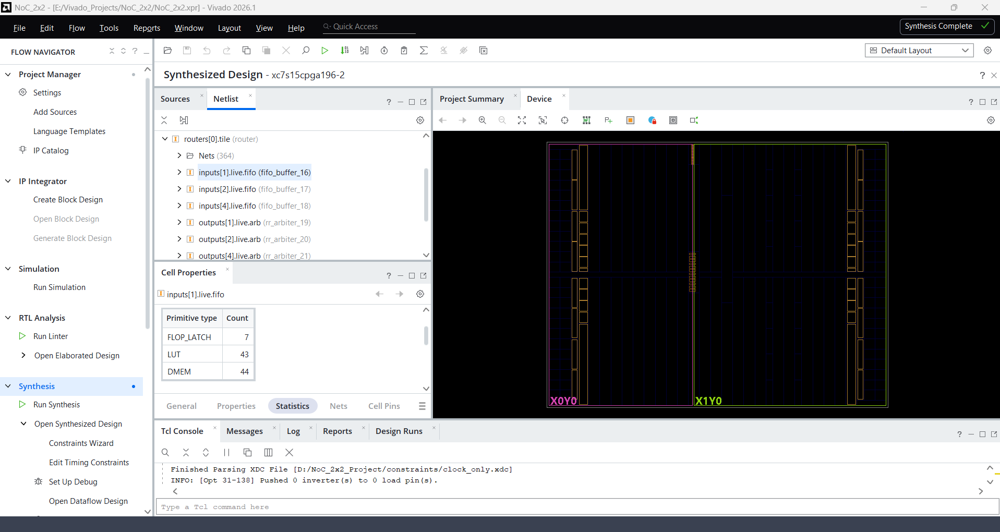

The selected FIFO shows FLIP_LATCH=7, LUT=43 and DMEM=44 primitive-class entries.
Synthesis maps storage and control into FPGA cells; these are not additive Slice-LUT totals.

## 16 — Core synthesis hierarchy

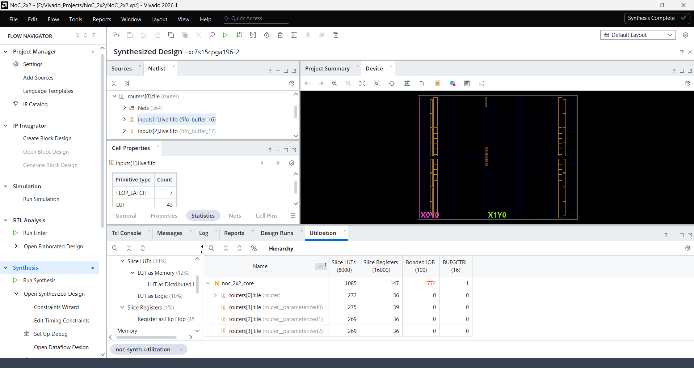

The later GUI run reports 1085 LUTs and 147 registers, with four router rows.
The archived core OOC result is separately 1086/147; the runs must not be merged.

## 17 — Core utilization and I O limit

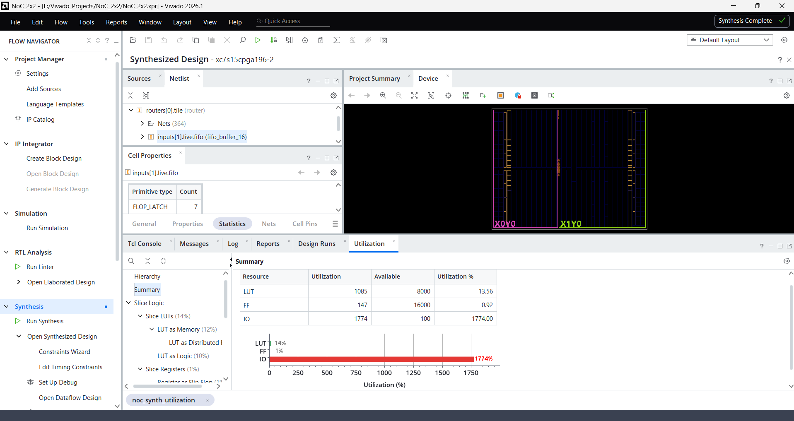

Core logic fits: 1085/8000 LUTs and 147/16000 registers.
Its 1774 logical I/O demands exceed 100 package pins; this exposed core is not a board top.

## 18 — Memory LUTs by router

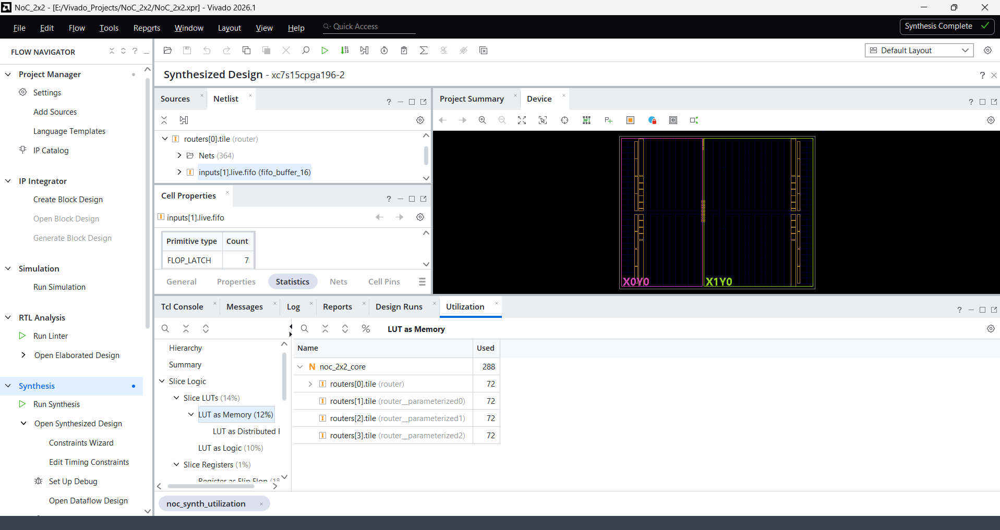

The core uses 288 LUTs as memory; each of the four routers contributes 72.
These are FPGA resources, not packets or bits. The next view resolves Router 0 FIFO detail.

## 19 — Three FIFO memory breakdown

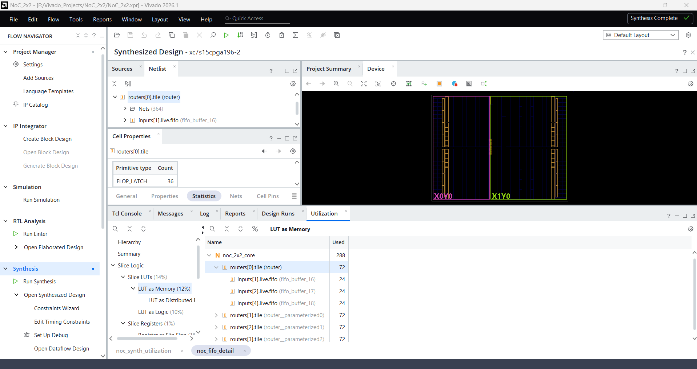

Router 0 inputs[1], inputs[2] and inputs[4] use 24 memory LUTs each: 24+24+24=72.
The third row accounts for the earlier apparent gap; a count of 24 is not FIFO depth 24.

## 20 — Pre route timing summary

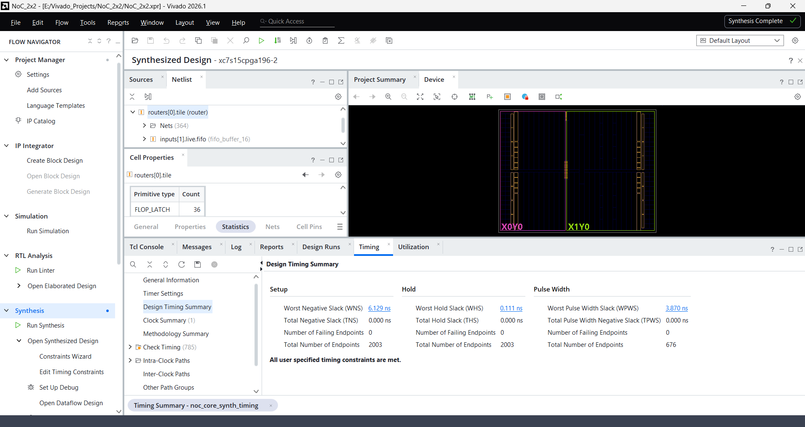

The GUI core reports WNS +6.129 ns, TNS 0 and WHS +0.111 ns.
Internal reported paths meet the target; 785 Check Timing findings still need interpretation.

## 21 — Missing external delay constraints

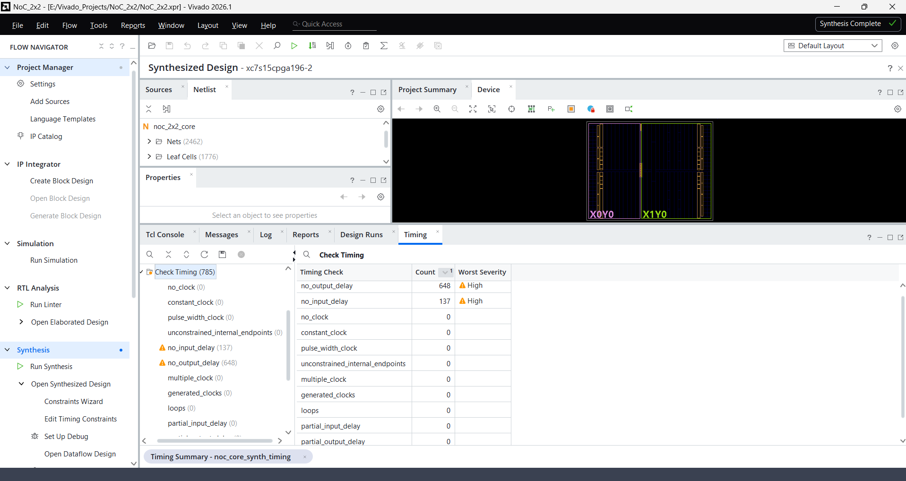

Check Timing lists 137 missing input delays and 648 missing output delays.
Their sum is 785 constraint findings, not failed packets. Board-interface timing is incomplete.

## 22 — Clock target

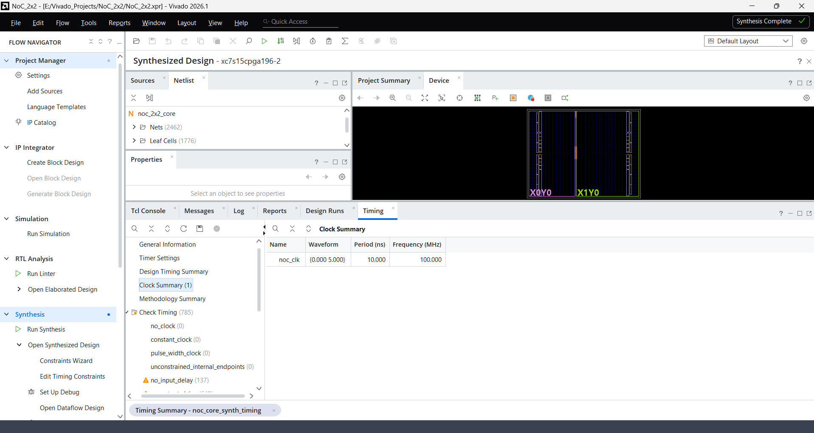

Clock Summary defines noc_clk at 10.000 ns, equivalent to 100 MHz.
This is a design constraint, not measured oscillator frequency, packet latency or fMAX.

## 23 — Ports without input delays

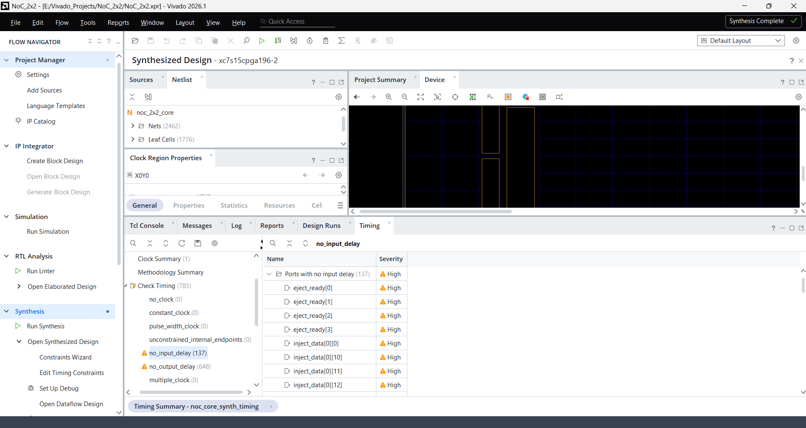

The list includes eject_ready and inject_data bits among 137 unconstrained inputs.
Vivado needs external arrival-time constraints before a board-interface timing claim is possible.

## 24 — Worst synthesized setup path

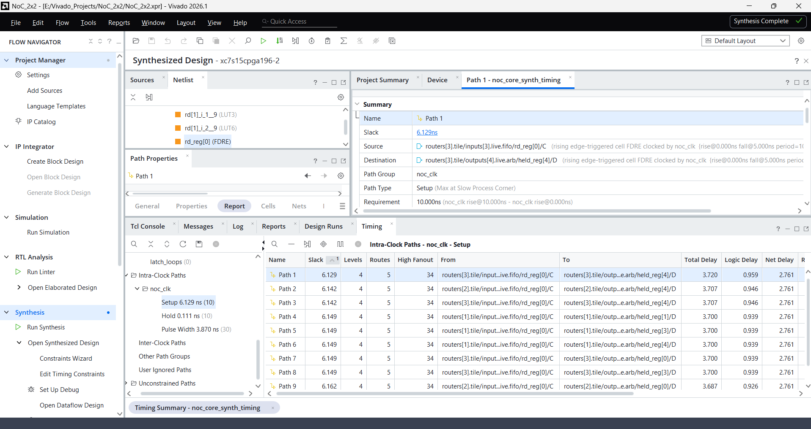

Router 3 FIFO read-pointer to Local arbiter: 3.720 ns path delay, +6.129 ns slack.
This is a pre-route circuit delay, not packet latency; slack includes clock and setup terms.

## 25 — Routed demo placement

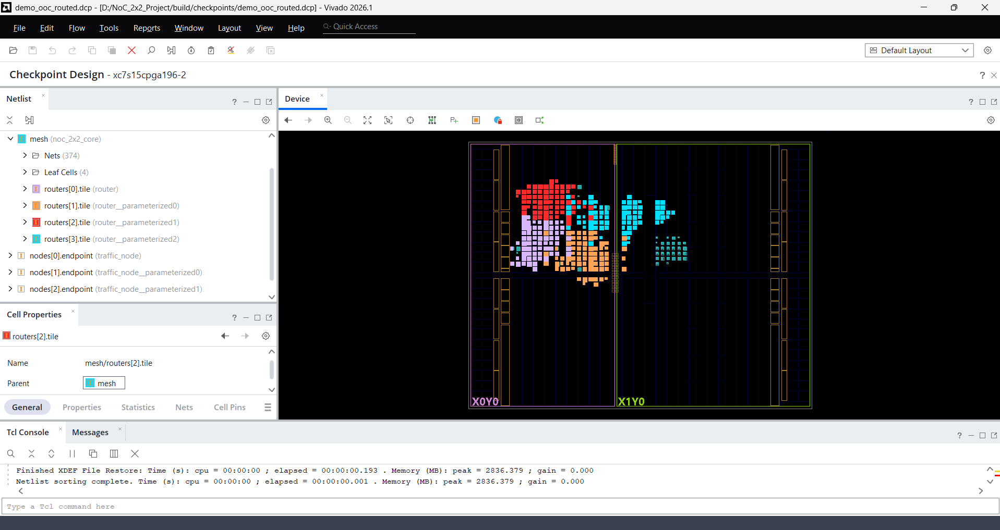

Four colored router cell groups appear in the saved demonstration checkpoint.
Colors identify placed logic, not packets. Logical mesh connections need not form a physical square.

## 26 — Routing completion

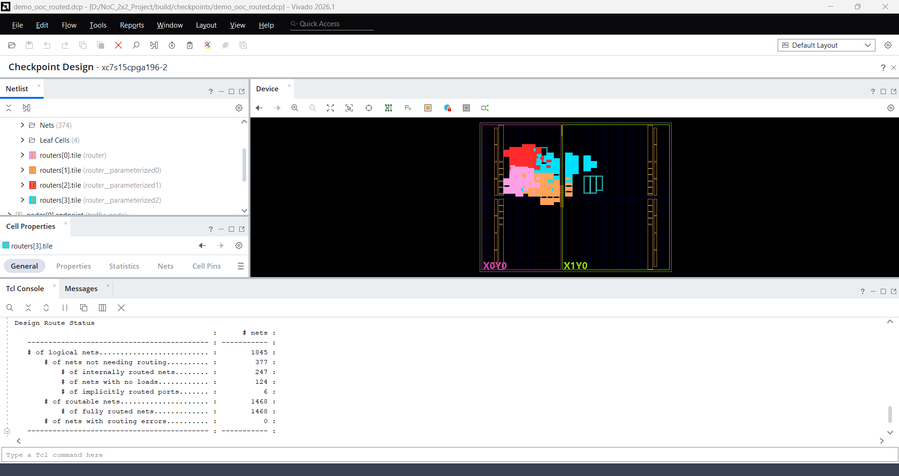

All 1468 routable nets are fully routed, with zero routing errors.
The remaining 377 of 1845 logical nets need no fabric routing; this does not prove board operation.

## 27 — Routed internal static timing

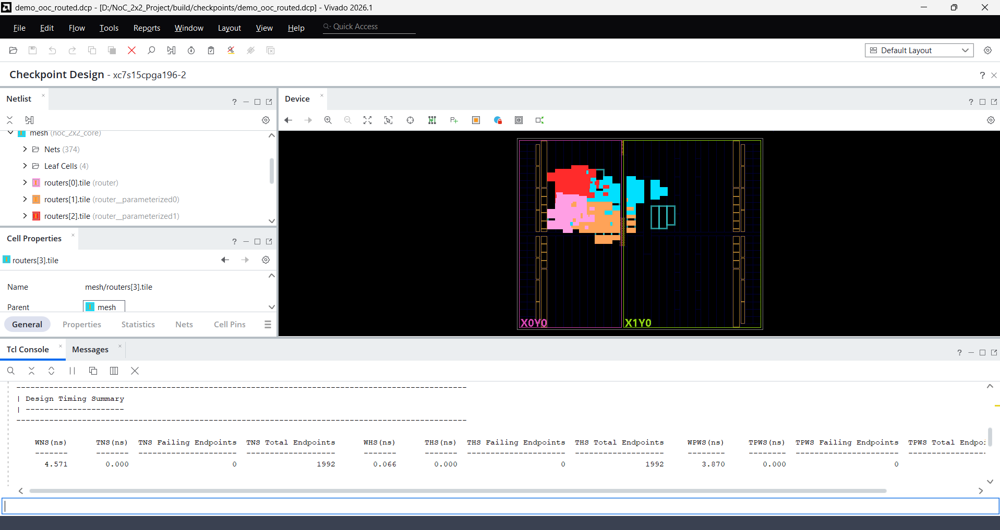

At 10 ns: WNS +4.571 ns, TNS 0, WHS +0.066 ns and THS 0.
These OOC internal checks pass. External board timing and SDF waveform simulation remain separate.

## 28 — Routed demonstration resources

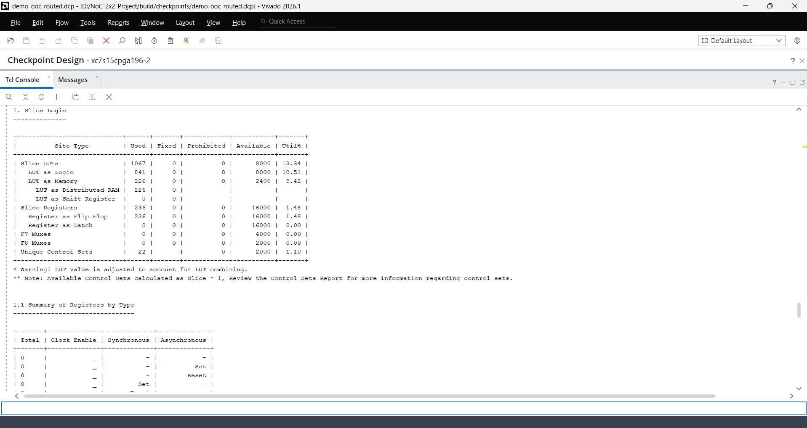

The demo uses 1067 LUTs (841 logic + 226 memory) and 236 registers.
This top includes four finite endpoints, so its cost differs from the exposed core-only run.

## 29 — Design rule warnings

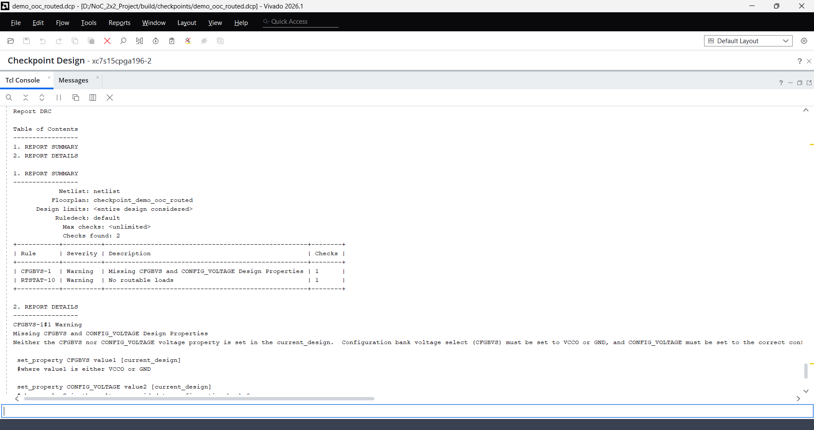

CFGBVS-1 requests configuration-voltage properties; RTSTAT-10 flags unloaded nets.
Two warnings and no DRC errors are shown. Board-specific values must be verified, not invented.

## 30 — Implemented Local arbiter schematic

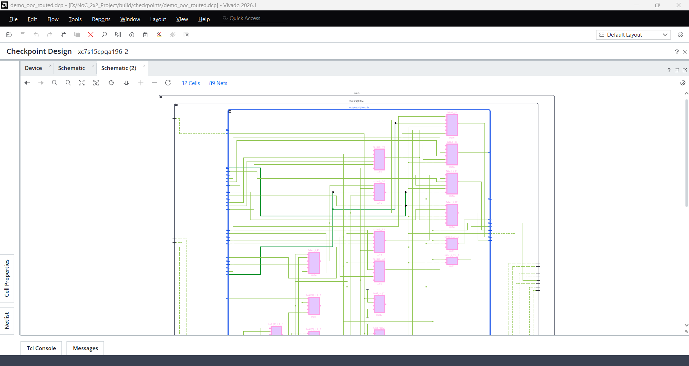

The selected routed arbiter view contains 32 cells and 89 nets, including LUTs and FDREs.
The wires are logical connections. The functional tests, rather than this picture, check fairness.

## 31 — Worst routed setup path

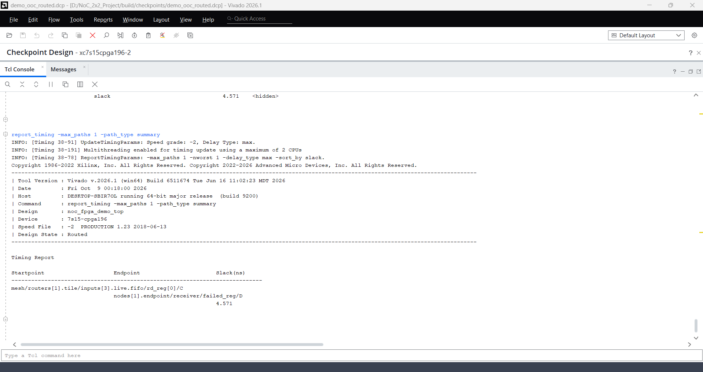

Router 1 FIFO read-pointer to endpoint 1 receiver failed_reg has +4.571 ns slack.
failed_reg names an error-status register; its name is not a simulation failure result.

## EXTRA A — Additional elaborated RTL schematic

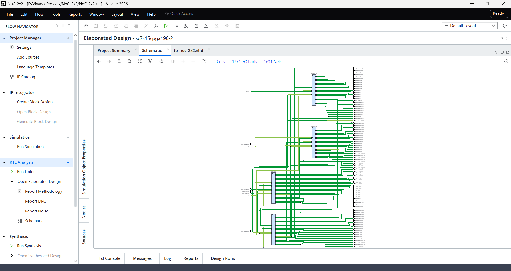

This context image shows the connected four-router core and its many logical ports.
It supplements the numbered sequence and provides an additional view of the connected RTL hierarchy.

## EXTRA B — Additional synthesis status

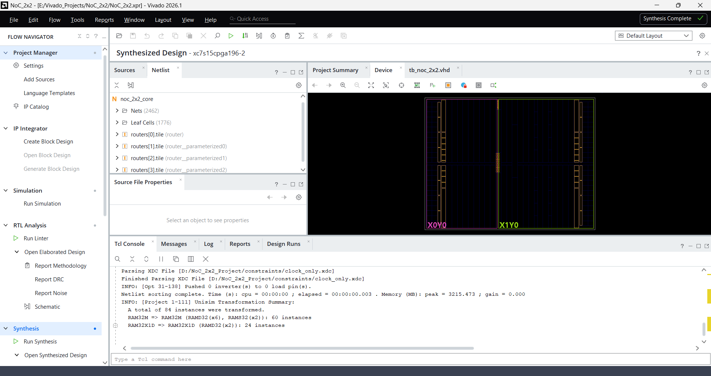

Vivado displays synthesis completion and the synthesized core hierarchy.
This status view supplements the detailed utilization and timing results in the numbered sequence.

## EXTRA C — Router 0 synthesized FIFO interface

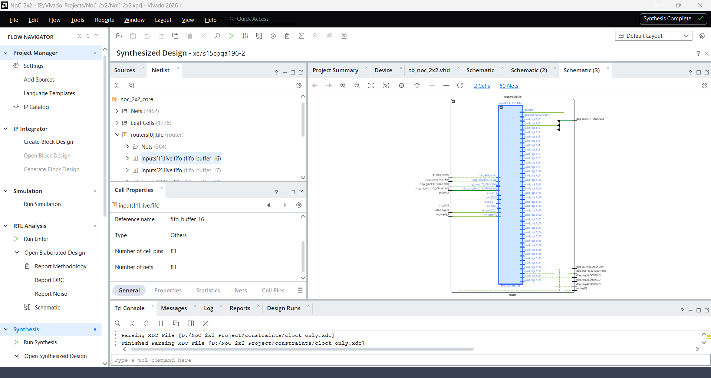

The selected inputs[1].live.fifo is the Router 0 South-input FIFO in the synthesized core.
Its 83 cell pins and 83 associated nets describe connectivity, not queue depth or packet count.

## EXTRA D — Synthesized FIFO interface close view

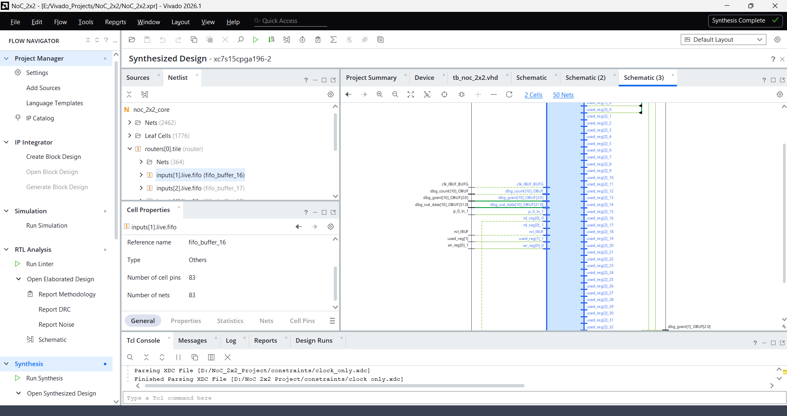

Clock, reset, read/write-pointer and debug-data connections are visible around the selected FIFO.
This zoomed view shows interface wiring; some pins are outside the displayed area.

## EXTRA E — Partial view after FIFO expansion

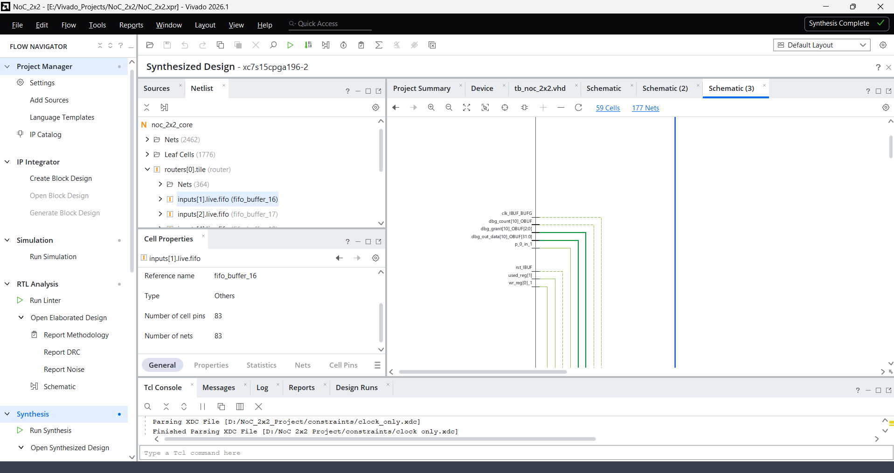

After expansion, the schematic reports 59 cells and 177 nets, but only part of the circuit is visible.
This is a partial navigation view; the next image shows the expanded FIFO fitted into the window.

## EXTRA F — Expanded synthesized FIFO circuit

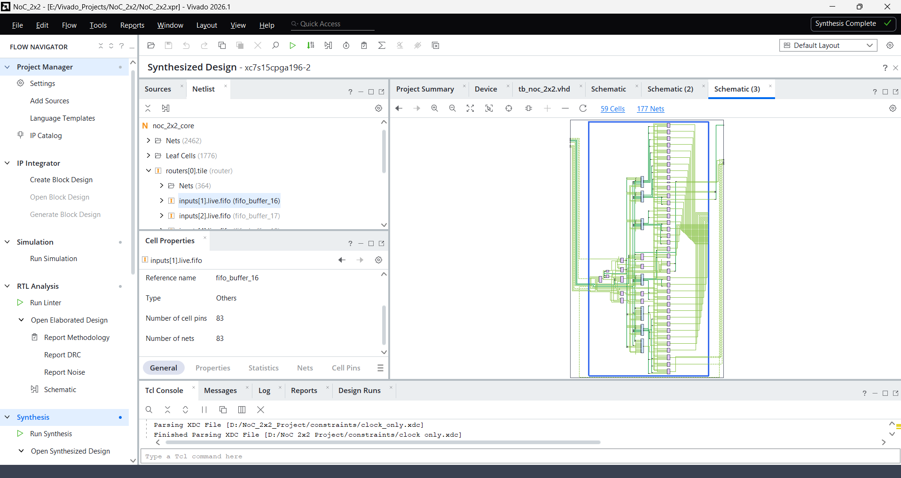

The fitted view exposes the mapped storage and control cells inside the selected FIFO.
The 59 cells and 177 nets belong to this schematic view, not the entire mesh utilization.

## EXTRA G — Router 0 in the routed checkpoint

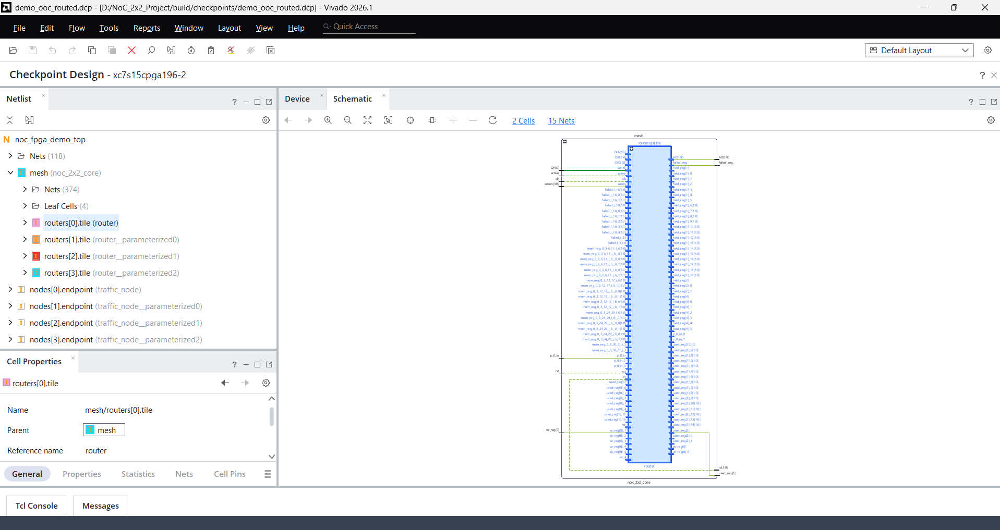

The saved demo_ooc_routed checkpoint shows Router 0 inside the mesh and all four traffic endpoints.
The green lines are logical net connections; this view records the implemented hierarchy.

## EXTRA H — Expanded router in the routed checkpoint

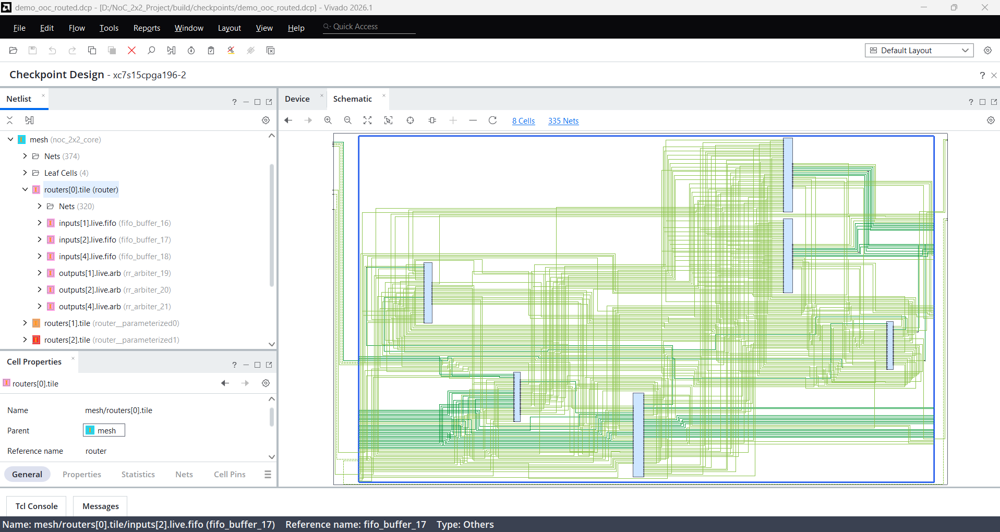

Router 0 expands into three active input FIFOs and three output arbiters: South, East and Local.
The view shows 8 cells and 335 nets, revealing how buffering and output-selection logic connect.

## EXTRA I — Local output arbiter interface

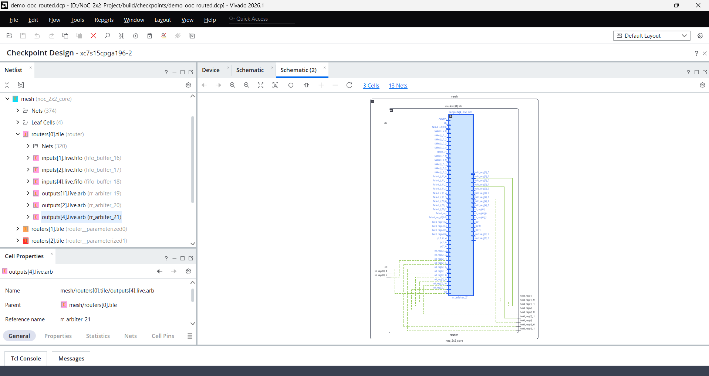

outputs[4].live.arb selects Router 0 Local-output round-robin arbiter, reference rr_arbiter_21.
Clock, reset and control connections locate the logic that selects packets for local delivery.

## EXTRA J — Expanded Local output arbiter circuit

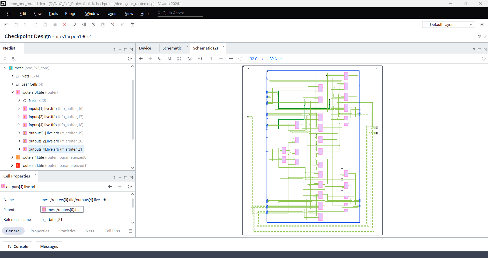

The expanded Local-output arbiter view contains 32 cells and 89 nets in the routed checkpoint.
It exposes the mapped selection and state circuitry; functional tests check its behavior.
