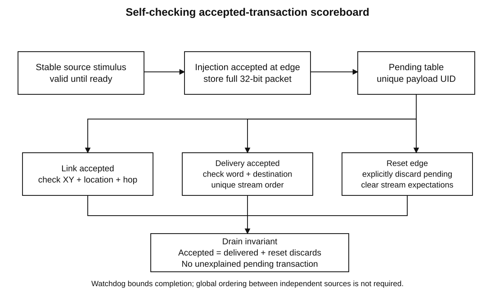

# Verification matrix

All observed passes below are **GHDL 4.1.0 supplemental RTL simulation**. Vivado 2026.1 XSim rerun is required independently. The same VHDL tests are supplied for XSim, but their portability to that exact build is not asserted until executed.

| Requirement | Test / stimulus | Assertion or observation | Supplemental status |
| --- | --- | --- | --- |
| T1 P00→P01 | tb_noc_2x2: source 0, destination 1 | One East hop; complete-word delivery at node 1 | PASS, depth 4 |
| T2 P00→P11 | Source 0, destination 3 | 0→1→3; two hops; six-cycle latency when empty/ready | PASS, depth 4 |
| T3 P10→P01 | Source 2, destination 1 | 2→3→1; East then North | PASS, depth 4 |
| T4 same-output contention | tb_rr_arbiter, tb_router and hotspot | Rotation by successful grants; three-input contention at all 12 active outputs | PASS |
| T5 downstream stall | Arbiter: 8 edges; router: 9; mesh: 35 | Held grant/data; no pop before acceptance; successful drain | PASS |
| T6 FIFO capacity | Depths 1/3/4/8 and mesh congestion | Count/ready guard capacity; full+pop refuses the push | PASS |
| T7 four sources | Mesh hotspot/reset recovery; 64-packet demo | Correct full-word delivery or explicitly accounted reset discard | PASS |
| T8 reset | Initial, idle, arbiter and mesh-pending resets | Defined pointers/grants/valid; explicit flush accounting | PASS |
| All 16 coordinate pairs | Route unit and mesh pair loops | Pair mask FFFF; shortest-hop count; Local when equal | PASS |
| All 8 directed links | Mesh link-coverage mask | Every active nonlocal output exercised; unused ports never requested | PASS |
| FIFO/stream order and wrap | 1200 cycles per FIFO depth; mesh counters | Complete-word FIFO order and per-source/destination stream order | PASS |
| Concurrent outputs | Three distinct outputs at each corner | Simultaneous acceptance from different inputs | PASS |
| Successful-grant fairness | Five persistent requests; 40 accepted grants | Each served within five successes; stalled time excluded | PASS |
| Reset with pending traffic | Directed mesh, depth 4 | 106 accepted = 74 delivered + 32 explicit discards; zero outstanding | PASS |
| Controlled experiments | 93 depth/workload/seed configurations | 82,523 accepted = 82,523 delivered; zero outstanding | PASS |
| Hardware and STA | Vivado and verified board unavailable | Exact-tool reports and physical evidence remain required | PENDING |

## Actual run count

Four FIFO depth runs + one route + one arbiter + four corner router runs + one demo + three directed mesh depths = fourteen. Depth-four integration passed before depth-two/eight experiments. Four FIFO tests include non-power-of-two depth three. All errors use severity failure or finite watchdog; scripts require process success and a top-specific PASS marker. Compile/elaboration logs are saved, including warnings. Actual directed outputs are 78/60/18 at depth 2, 106/74/32 at depth 4, 158/102/56 at depth 8 (accepted/delivered/reset-discarded). These reset experiments are not loss-free end-to-end delivery benchmarks.

